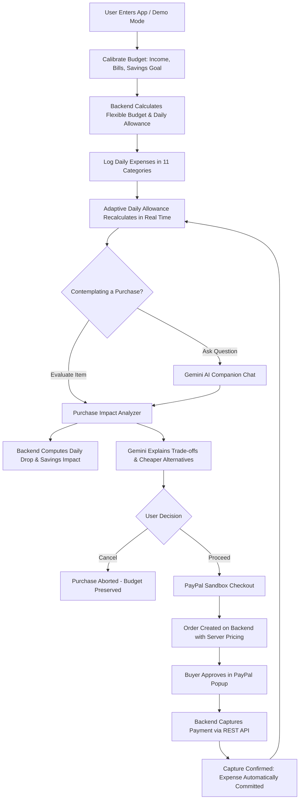
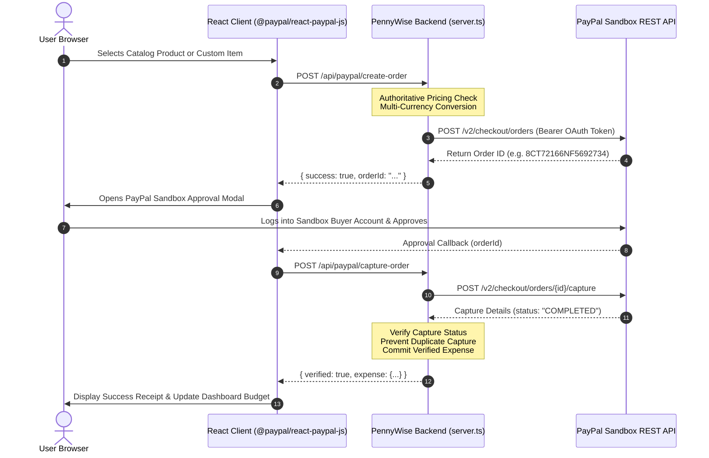

# PennyWise AI 🪙✨

> **Your AI-powered personal finance companion.**  
> *Smart money decisions. Better financial growth.*

[](https://nodejs.org/)
[](https://react.dev/)
[](https://www.typescriptlang.org/)
[](https://tailwindcss.com/)
[](https://firebase.google.com/)
[](https://aistudio.google.com/)
[](https://developer.paypal.com/)
[](https://nodejs.org/api/test.html)

---

## 📌 Project Overview

**PennyWise AI** is an intelligent, responsible personal finance companion that transforms passive budgeting into active, informed decision-making. Built from the ground up for the **PayPal AI Hackathon**, it combines deterministic mathematical budget modeling with **Google Gemini 3.8 Flash** conversational intelligence and authentic **PayPal Sandbox REST API** checkout verification.

Rather than merely displaying historical charts of money already spent, PennyWise AI provides an **adaptive daily spending allowance**, evaluates planned purchases against current budget pacing and protected savings goals, suggests lower-cost alternatives, and connects validated purchase decisions directly to PayPal Sandbox checkout.

```
┌────────────────────────────────────────────────────────────────────────┐
│                        [ PennyWise AI Logo ]                           │
│              Replace with: docs/screenshots/logo.png                   │
└────────────────────────────────────────────────────────────────────────┘
```

---

## 💡 Inspiration

Traditional personal finance tools suffer from a fundamental usability gap: they act as post-mortem accountants rather than forward-looking companions. They inform users of budget overruns *after* the credit card has been swiped, but offer little assistance when a consumer is standing at a checkout counter or browsing an e-commerce catalog asking:

> *"Can I afford this right now without compromising my rent, my emergency fund, or my savings target for the month?"*

I built **PennyWise AI** to solve this dilemma. I wanted an empathetic, mathematically disciplined financial partner that tells me exactly what I can spend today, calculates the precise micro-impact of every purchase before I commit, suggests sensible alternatives, and allows me to test actual checkout execution through PayPal Sandbox in a safe, simulated environment.

---

## 🎯 What PennyWise AI Does

PennyWise AI helps users answer four everyday financial questions in plain language:

1. **"What is my safe spending limit today?"**  
   It calculates an **adaptive daily spending allowance** based on monthly income, essential fixed bills, active savings targets, and remaining days in the billing period.
2. **"Can I afford to buy this item?"**  
   Through the **Purchase Impact Analyzer**, users input any planned purchase. The backend determines whether the item fits within flexible funds, cautions if it tightens daily pacing, or warns if it would cut into savings.
3. **"What cheaper alternatives can I consider?"**  
   Gemini AI analyzes the purchase category and priority to recommend high-value alternatives, trade-offs, and pacing strategies.
4. **"How does checkout translate into my budget?"**  
   Users can test simulated purchases using integrated PayPal Sandbox buttons. Verified captures automatically create authentic expense records in the user's ledger, dynamically adjusting the remaining budget.

---

## ✨ Key Features

### 1. Deterministic Budget Calibration
- **Structured Income & Allocation**: Configurable monthly income, essential fixed commitments (rent, utilities, insurance), monthly savings targets, and emergency buffers.
- **Flexible Budget Derivation**: Authoritative backend calculation of discretionary spending capital:  
  $$\text{Flexible Budget} = \text{Monthly Income} - \text{Essential Commitments} - \text{Savings Target}$$
- **Cycle Period Calibration**: Automatically tracks days elapsed, days remaining, and period completion percentages.

### 2. Dynamic Adaptive Daily Allowance
- **Initial Baseline vs. Adaptive Daily**: Compares the static baseline daily allowance against an active allowance that recalculates dynamically as discretionary spending occurs:  
  $$\text{Adaptive Daily Allowance} = \frac{\text{Remaining Flexible Budget}}{\text{Days Remaining}}$$
- **Spending Pacing Indicators**: Visual badges indicate whether the user is *On Track*, *Ahead of Pace*, or *Overbudget*.

### 3. Expense Ledger & Categorization
- **11 Standard Financial Categories**: Groceries, Dining, Housing, Utilities, Transportation, Healthcare, Entertainment, Shopping, Education, Personal Care, and Other.
- **Essential vs. Discretionary Partitioning**: Each transaction is flagged to preserve essential commitments and monitor discretionary burn rate.
- **AI Category Suggestion**: Automatic category inference powered by Gemini based on title and description inputs.

### 4. Protected Savings Goals
- **Milestone Tracking**: Multiple dedicated savings goals with target dates, target amounts, current saved balances, and visual completion bars.
- **Timeline Feasibility Modeling**: Estimates required monthly pace and flags whether active discretionary spending trends put targets at risk.

### 5. Gemini 3.8 Flash Conversational Companion
- **Multi-Turn Financial Chat**: Conversational interface maintaining user financial context across turns.
- **Zero Hallucination Guarantee**: The assistant receives authoritative budget numbers from the backend; it never invents account balances, exchange rates, or affordability verdicts.
- **Quick Action Triggers**: Emits contextual actions that pre-populate the Purchase Analyzer or navigate to relevant tabs.
- **Supportive Tone**: Friendly, non-judgmental guidance that explains financial trade-offs without shaming.

### 6. Purchase Impact Analyzer & Cheaper Alternatives
- **Pre-Purchase Feasibility Check**: Models the exact post-purchase state (new remaining flexible budget, resulting daily allowance drop, and savings deficit) before spending.
- **Priority Classification**: Classifies items into *Need*, *Want*, or *Luxury*.
- **Alternative Recommendations**: Gemini suggests lower-cost alternatives and waiting periods.
- **Checkout or Cancel Action Gates**: Users have full control to proceed to PayPal Checkout, log directly as an expense, or cancel.

### 7. PayPal Sandbox REST API Checkout
- **Server-Authoritative Product Catalog**: 8 built-in demo lifestyle and productivity products with server-validated prices to prevent client-side amount tampering.
- **Custom Evaluated Item Purchases**: Seamlessly transfers items analyzed in the Purchase Impact Analyzer into PayPal order creation.
- **Interactive PayPal Buttons**: Powered by `@paypal/react-paypal-js` for authentic buyer login, shipping selection, and payment approval.
- **Backend Capture Verification**: Enforces server-to-server capture verification before any transaction is logged as an expense.
- **Webhook Audit Ledger**: Simulates and displays asynchronous PayPal webhook events (`PAYMENT.CAPTURE.COMPLETED`, `DENIED`, `REFUNDED`) with cryptographic signature checks.

### 8. Multi-Currency Engine
- **20+ Global Currencies**: USD, EUR, GBP, JPY, CAD, AUD, INR, BRL, SGD, AED, and more.
- **Verified Exchange Rates**: Authoritative conversion rates with explicit approximate-rate disclosures.
- **Zero-Decimal Handling**: Native formatting and calculations for zero-decimal currencies (JPY, KRW, VND, CLP).

### 9. Authentication & User Boundary Isolation
- **Firebase Authentication**: Supports Google Sign-In and Email/Password registration.
- **Cloud Firestore Security Rules**: Attribute-Based Access Control (ABAC) strictly confines data reads and writes to `request.auth.uid == userId`.
- **Anti-Tamper Protections**: Verified PayPal transaction records cannot be modified or deleted via client SDKs.

### 10. Instant Demo Mode
- **Zero-Friction Evaluation**: Allows hackathon judges to explore the full dashboard with realistic sample data without signing up or creating an account.

---

## 🛠️ Technology Stack

| Layer | Technologies | Role & Implementation Details |
| :--- | :--- | :--- |
| **Frontend UI** | **React 19**, **TypeScript**, **Tailwind CSS v4** | Modular functional components, custom hooks, accessible modals, and responsive layout. |
| **Icons & Motion** | **Lucide React**, **Motion (Framer Motion)** | Consistent iconography, smooth tab transitions, and animated budget indicators. |
| **Client Payment SDK** | **`@paypal/react-paypal-js` (v10.6.1)** | Official PayPal JavaScript SDK wrapper rendering authentic Sandbox payment buttons. |
| **Backend Server** | **Node.js**, **Express 4.21**, **Vite / tsx** | Express API server mounting REST routes with Vite development middlewares in `server.ts`. |
| **AI Engine** | **Google Gemini 3.8 Flash** via **`@google/genai` (v2.4.0)** | Server-side conversational companion, purchase impact narrator, and category inference engine. |
| **Authentication** | **Firebase Auth (v13.2.0)** | Client-side Google OAuth popup and Email/Password identity management. |
| **Database** | **Cloud Firestore** | Cloud document database storing user profiles, budgets, expenses, savings goals, and orders under strict ABAC rules. |
| **Payment Backend** | **PayPal Sandbox REST API v2** | Server-to-server OAuth 2.0 token management, order creation, capture verification, and webhook processing. |
| **Testing** | **Node.js Native Test Runner (`tsx --test`)** | 57 automated unit tests validating budget mathematics, currency conversions, savings analytics, PayPal verification, and Firestore security invariants. |

---

## 🔄 How It Works: The User Journey



### Step-by-Step Walkthrough

1. **Sign-In & Onboarding**: The user signs in via Google or Email/Password (or clicks **Explore Demo** for instant test drive).
2. **Budget Setup**: The user inputs monthly take-home pay, essential fixed expenses (rent, utilities), and a target savings amount.
3. **Pacing Calculation**: The deterministic backend engine sets the monthly flexible budget and derives the baseline and adaptive daily spending allowance.
4. **Expense Logging**: As the user logs discretionary expenses, the remaining flexible budget decreases and the daily allowance adapts dynamically to the remaining days.
5. **AI Interaction**: The user chats with PennyWise AI to ask questions like *"Can I afford dinner tonight?"* or *"Where is most of my money going?"*
6. **Purchase Analysis**: When considering an item, the user inputs the name and price in the Purchase Analyzer. The engine computes the exact post-purchase allowance and determines whether it cuts into savings.
7. **Alternative Exploration**: Gemini provides a clear explanation and suggests lower-cost alternatives.
8. **PayPal Checkout**: If the user chooses to proceed, the item transfers to PayPal Checkout. An authoritative order is created, the buyer approves in the PayPal Sandbox popup, and the backend verifies capture before appending the expense.

---

## 🤖 AI Integration & Architecture

### Model Configuration
- **Model**: `gemini-3.8-flash`
- **SDK**: Official `@google/genai` TypeScript SDK (v2.4.0)
- **Deployment**: Strictly server-side (`src/server/geminiService.ts`). The API key is never exposed to the frontend.

### Strict Separation: Deterministic Math vs. AI Guidance
A core design tenet of PennyWise AI is **never allowing the LLM to independently compute official financial metrics**. Generative AI models can hallucinate arithmetic; financial software cannot.

```
┌─────────────────────────────────────────────────────────────┐
│                 DETERMINISTIC BACKEND ENGINE                │
│  - Calculates Remaining Flexible Budget                     │
│  - Calculates Exact Adaptive Daily Allowance                │
│  - Determines Mathematical Affordability Verdict            │
│  - Computes Currency Conversions with Verified Rates        │
└──────────────────────────────┬──────────────────────────────┘
                               │ Structured Context
                               ▼
┌─────────────────────────────────────────────────────────────┐
│                 GEMINI 3.8 FLASH COMPANION                  │
│  - Receives Verified Financial Figures                      │
│  - Explains Practical Daily Lifestyle Impacts               │
│  - Suggests Cheaper Alternatives and Prioritization         │
│  - Emits Structured UI Actions (open analyzer, etc.)        │
│  - Enforces Educational Disclaimer                          │
└─────────────────────────────────────────────────────────────┘
```

### Context Injected into Gemini
When generating conversational responses or purchase impact narratives, the server supplies a sanitized financial snapshot:
- `monthlyIncome`
- `essentialExpenses`
- `savingsTarget`
- `remainingFlexibleBudget`
- `adaptiveDailyAllowance`
- `daysRemaining` in the period
- `currency` and symbol
- Recent transaction patterns

### Core AI Safety Principles
- **No Payment Initiation**: Gemini can never trigger, approve, or capture payments.
- **No Absolute Guarantees**: Gemini explains mathematical feasibility, but reminds users that the final purchasing decision remains theirs.
- **Educational Scope**: Clarifies that advice is for budgeting awareness and does not constitute professional investment or tax advice.

---

## 💳 PayPal Integration

### Why PayPal?
PayPal is the global standard for frictionless digital payments. Integrating PayPal Sandbox elevates PennyWise AI from an advisory dashboard into an active financial decision gateway. Users can simulate the full lifecycle of an online purchase—from initial affordability doubt to verified payment completion.

### Integration Flow



### Key Security & Reliability Measures
1. **Authoritative Server Pricing**: Client-side prices are ignored; the server validates all catalog items against `DEMO_PRODUCTS` and applies server-controlled exchange rates for custom items.
2. **Idempotency & Duplicate Prevention**: Order IDs are tracked in backend state to prevent double-capture exploits.
3. **Verified Expense Linking**: An expense is written to the ledger **only** when the PayPal REST API explicitly returns `status: "COMPLETED"`.
4. **Webhook Cryptographic Verification**: Webhook events check PayPal signature headers (`paypal-transmission-id`, `paypal-cert-url`, `paypal-transmission-sig`) to safeguard against replay attacks and SSRF.

---

## 📸 Application Screenshots

*(Screenshots can be placed in `docs/screenshots/`)*

| Screen | Placeholder | Description |
| :--- | :--- | :--- |
| **Landing Page** | `docs/screenshots/landing.png` | Hero section with live simulation dashboard preview, 4-step workflow, and authentication modal. |
| **Dashboard** | `docs/screenshots/dashboard.png` | Featured hero card for Today's Allowance, 3 financial KPI cards, category distribution bar, and projections. |
| **Budget Calibration** | `docs/screenshots/budget.png` | Monthly income, fixed essentials, savings goal setup, and breakdown visualizer. |
| **Expense Tracker** | `docs/screenshots/expenses.png` | Transaction logging form with 11 categories, essential flags, and PayPal badges. |
| **Savings Goals** | `docs/screenshots/savings.png` | Dedicated savings goal cards with milestone bars, pace feasibility, and educational disclaimers. |
| **AI Assistant Chat** | `docs/screenshots/ai-chat.png` | Conversational chatbot with recommended prompts, quick actions, and typing indicator. |
| **Purchase Impact Analyzer** | `docs/screenshots/purchase-analyzer.png` | Pre-purchase feasibility calculator showing post-purchase allowance drop and Gemini analysis. |
| **PayPal Sandbox Checkout** | `docs/screenshots/paypal-checkout.png` | Product catalog, custom checkout, authentic PayPal buttons, and verified receipt modal. |

---


## 🛡️ Security Implementation

As an application dealing with financial planning and simulated payments, PennyWise AI enforces a multi-layer security posture:

1. **Server-Side API Key Protection**:  
   The `GEMINI_API_KEY` and `PAYPAL_CLIENT_SECRET` are never exposed to the browser, bundled in client JavaScript, or transmitted in client headers.
2. **Zero-Trust Firestore Security (`firestore.rules`)**:  
   - All document paths are partitioned under `/users/{userId}`.
   - Every read, create, update, and delete operation validates `request.auth.uid == userId`.
   - Blanket listing of all users is forbidden.
   - String boundaries, positive number validations, and strict schema validation helpers are enforced on every write.
3. **Immutable Payment Ledger**:  
   Transactions originating from PayPal cannot have their status altered by client calls, and verified payment records cannot be deleted via the client SDK.
4. **Zero Financial Credentials Requested**:  
   PennyWise AI never asks for bank account numbers, passwords, or credit card details. All simulated checkouts occur within PayPal's secure iframe/popup modal.

---

## 🔮 Future Scope & Roadmap

While PennyWise AI provides a complete end-to-end prototype for the hackathon, I have identified several exciting avenues for future expansion:

- [ ] **Predictive Cash Flow & Subscription Tracking**: Proactive alerts before recurring monthly bills renew.
- [ ] **Automated Receipt Scanning**: Multimodal Gemini image processing to parse printed paper receipts and extract line items into categories.
- [ ] **Live PayPal Production Integration**: Transitioning from Sandbox to verified PayPal merchant credentials following regulatory compliance and audit reviews.
- [ ] **Open Banking & Plaid Account Linking**: Optional read-only bank feed synchronization for automated expense ingestion.
- [ ] **Progressive Web App (PWA) Offline Sync**: Service worker caching and offline transaction queueing for mobile users on the go.

---

## 🎥 Demonstration

- **Live Application URL**: `[Insert Hosted App URL Here]`
- **YouTube Video Walkthrough (Under 3 Minutes)**: `[Insert YouTube Video Link Here]`

---

## 📄 License

This project was built for the PayPal AI Hackathon. Licensing information will be declared in the repository root prior to general open-source distribution.

---

## 👨‍💻 Developer & Journey

PennyWise AI was designed, architected, and developed independently by me as a solo creator for the **PayPal AI Hackathon**.

Throughout this development journey, my objective was to demonstrate how modern AI could be combined with rigorous deterministic engineering: utilizing **Google Gemini 3.8 Flash** not as an unaccountable black-box calculator, but as an articulate, empathetic financial advisor anchored to verifiable mathematical models and authentic **PayPal** payment infrastructure.

---

## ⚠️ Educational Disclaimer

*PennyWise AI is an educational personal finance budgeting tool and experimental prototype. It does not provide certified financial, legal, tax, or investment advice. All financial figures are deterministic approximations based on user-provided inputs. All PayPal transactions shown are executed within the simulated PayPal Sandbox testing environment and do not involve real money.*
